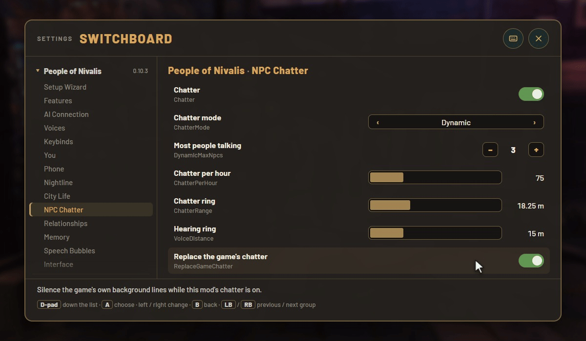

# Nivalis Switchboard

<p align="center"></p>

An in-game settings menu for Nivalis Nights mods that support it ([People of Nivalis](https://github.com/skyehosting/PeopleOfNivalis),
and more as they come). It finds them by itself and shows every one of their settings, grouped the way their settings
files are, and every change applies at once. Nothing needs it: without it, each mod's settings are still in its file in
`BepInEx\config`.

**[Download the latest release](https://github.com/skyehosting/NivalisSwitchboard/releases/latest)**

## Install

You need Nivalis Nights with [BepInEx](https://builds.bepinex.dev/projects/bepinex_be) for IL2CPP games (its
bleeding-edge build) in the game folder.

1. Close the game.
2. Drag the zip's `BepInEx` folder into the game folder (where `Nivalis Nights.exe` is), so that you have
   `BepInEx\plugins\NivalisSwitchboard\NivalisSwitchboard.dll`.
3. Start the game. The title menu and the pause menu now have **Switchboard** under Settings.

To uninstall, delete `BepInEx\plugins\NivalisSwitchboard` (and `BepInEx\config\NivalisSwitchboard.cfg`).

## Use

- Open it with **F9**, the **Switchboard** button (also with a controller), or People of Nivalis's cog beside a chat
  or the console.
- Down the left: each mod, with its groups under it. On the right: that group's settings. Hover one to read what it does.
- Mouse: click a switch, click or drag a bar, open a list, type in a field (Enter saves, Esc puts it back).
- Controller: the d-pad or stick moves, A chooses, left and right change a setting, LB and RB go to the previous and
  next group, B goes back, and from the list of mods it closes the menu. A text field opens an on-screen keyboard.
- Keys and passwords show only "set" or "not set" and are typed hidden.
- Esc, F9 or the X closes it.

Its own settings (`BepInEx\config\NivalisSwitchboard.cfg`, and its own heading in the menu): the key, whether the
button is on the game's menus, and what the button says.

## For mod authors

To make your own mod's settings show up in the menu, see [CONTRACT.md](CONTRACT.md).

## Building from source

You need a recent .NET SDK and the game with BepInEx installed (the build references the game's `BepInEx\core` and
`BepInEx\interop`, which BepInEx generates on the game's first start).

```
dotnet build NivalisSwitchboard.csproj -c Release
```

Add `-p:GameDir="D:\path\to\Nivalis Nights"` if the game isn't in Steam's default folder. The tests need no game:
`cd tests` then `dotnet run -c Release`. Forks and pull requests are welcome.

## Licence

Nivalis Switchboard is © skyehosting, licensed under
[Creative Commons Attribution-NonCommercial-ShareAlike 4.0](https://creativecommons.org/licenses/by-nc-sa/4.0/)
(see [LICENSE](LICENSE)): credit and link back here, no commercial use, and anything made from it is shared under the
same licence. Nivalis Nights belongs to its owners; this mod is unofficial and contains none of the game's files.
